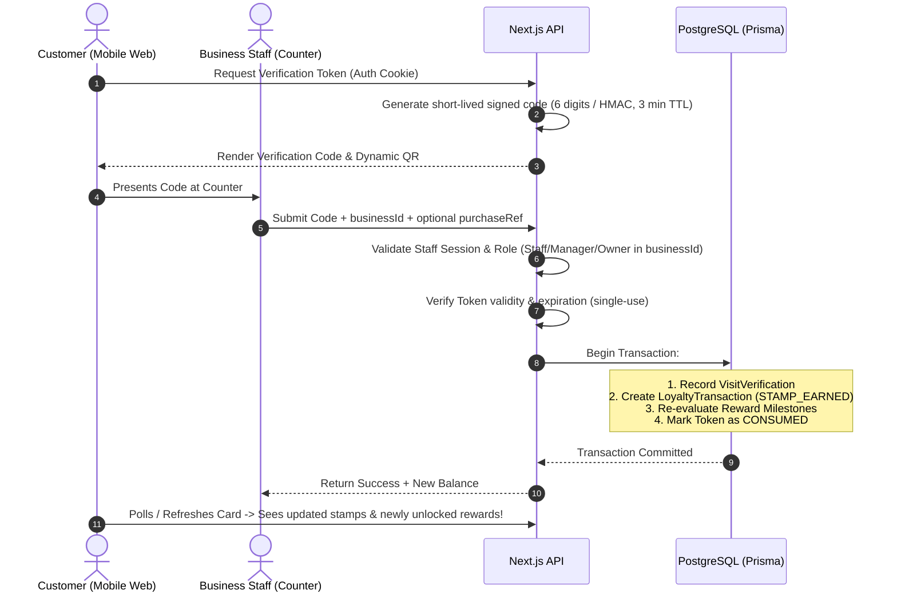

# Project Repeat — System Architecture

## Architecture Principles
1. **Multi-Tenant by Design**: Every request within the business context is scoped strictly to a verified `businessId`.
2. **Server-Authoritative State**: Balances, rewards eligibility, verification tokens, and permission checks are strictly computed on the server. The client never dictates loyalty balances or reward availability.
3. **Immutable Ledger Source of Truth**: All visit verification and stamp accruals append to `LoyaltyTransaction`. Aggregate balances can always be audited and reconciled from raw events.
4. **Resilient Abstraction Layers**:
   - `PaymentService` interface with `RazorpayPaymentProvider` and `MockPaymentProvider`.
   - `EmailService` interface with `ConsoleEmailProvider` and `ResendEmailProvider`.
   - `StorageService` interface with local/cloud object storage adapters.
5. **Zero-Trust Role-Based Access Control (RBAC)**:
   - `PLATFORM_ADMIN`
   - `BUSINESS_OWNER`
   - `BUSINESS_MANAGER`
   - `BUSINESS_STAFF`
   - `CUSTOMER`

---

## Directory Organization
```text
src/
  app/
    (marketing)/         # Public landing page, features, how it works, pricing, FAQ, contact
    (auth)/              # Sign in, sign up, password recovery, session handlers
    (customer)/          # Customer mobile wallet, loyalty card view, rewards, settings
    (business)/          # Business dashboard: overview, card builder, staff, visits, analytics
    (platform-admin)/    # Multi-tenant oversight, subscriptions, system audit logs
    api/                 # REST Route Handlers (auth, visits, loyalty, rewards, webhooks)
  components/
    ui/                  # Atomic accessible UI: Button, Input, Modal, Badge, Card, Table, Tabs
    layout/              # MarketingNav, BusinessSidebar, CustomerNav, Header, Footer
    loyalty/             # LoyaltyCard, StampGrid, StampIcon, RewardBadge, VerificationModal
    dashboard/           # MetricCard, ActivityTable, ChartContainer, EmptyState
  lib/
    auth/                # Session tokens, cookie management, password hashing, RBAC guards
    db/                  # Prisma client singleton, connection management
    validation/          # Zod schemas for forms, API payloads, and query params
    permissions/         # Permission matrix and guard functions (canManageProgram, canVerifyVisit)
    security/            # Verification token generation, HMAC signatures, rate limiter
    payments/            # Payment gateway provider abstraction (Razorpay, mock)
    email/               # Transactional email adapter (welcome, verification, notifications)
    qr/                  # QR code generation utilities for businesses and verification
  server/
    services/            # Core domain business logic (LoyaltyService, VerificationService, BillingService)
    repositories/        # Data access layer interfacing Prisma
  types/                 # Domain types, role enums, API request/response contracts
prisma/
  schema.prisma          # PostgreSQL relational schema
  seed.ts / seed.js      # Realistic demo data for Coffee Shop, Bakery, and Salon
docs/                    # Living system documentation
```

---

## Request & Security Flow (Visit Verification)

